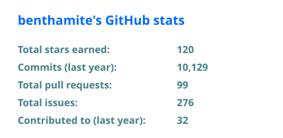
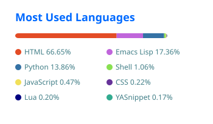
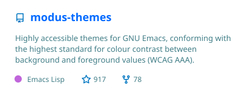

### Hi, I'm Pablo

I spend most of my time inside Emacs, managing my army of AI agents. You probably want to check out [my dotfiles](https://github.com/benthamite/dotfiles/tree/master) first.

  
  

#### Packages I contribute to

<!-- CONTRIBUTIONS:START -->

  
  
  
  
  
  
  
  
  
  

<!-- CONTRIBUTIONS:END -->

#### Packages I've developed

  
  
  
  
  
  
  
  
  
  
  
  
  
  
  
  
  
  
  
  
  
  

